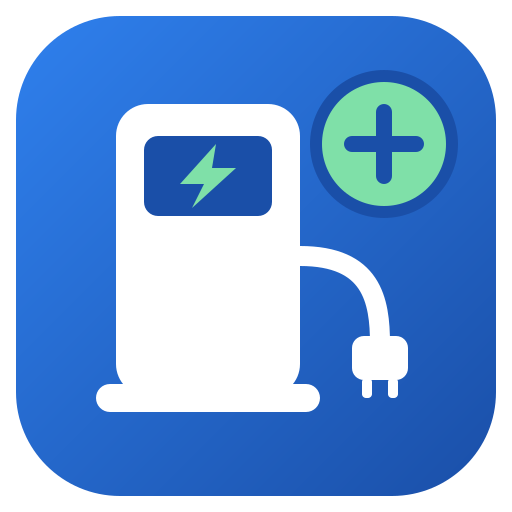

# Blue Current Plus

Onofficiële Home Assistant-integratie voor laadpalen van [Blue Current](https://www.bluecurrent.nl). Een alternatief voor de standaard `blue_current`-integratie: dezelfde cloudverbinding, maar met kloppende vermogens- en energiewaarden, bediening via gewone entiteiten (geen services) en meer inzicht in sessies en vergoedingen.

> Dit project staat los van Blue Current. Het gebruikt de websocket-API van Blue Current voor Home Assistant en, voor het tarief, een niet-gedocumenteerde API van my.bluecurrent.nl. Die kunnen zonder aankondiging veranderen.

## Wat zit erin

- **Juist laadvermogen**: per fase U × I, opgeteld. De standaard integratie rekent met gemiddelden en komt bij 3 × 16 A op zo'n 6,4 kW in plaats van ~11 kW.
- **Energie-dashboard**: een oplopende kWh-teller over alle sessies heen, bewaard over herstarts.
- **Max laadstroom als schuifregelaar**: wijzigingen worden gebundeld, zodat een automation of slider niet de dagelijkse request-limiet opmaakt.
- **Laadpas kiezen** voor de knop *Start laden*, met naam en EMP-id; je hoeft de RFID-UID niet zelf op te zoeken.
- **Vergoedingstarief** uitlezen en aanpassen (€/kWh excl. btw), ook vanuit een automation.
- **Sessievergoeding**: live schatting tijdens het laden, het bedrag van Blue Current zodra de sessie klaar is. Plus een teller voor de totale vergoeding.
- **Robuuste verbinding**: automatisch opnieuw verbinden, request-teller en een melding onder *Reparaties* als de limiet bereikt is of een andere client verbonden is.

## Installatie

Vereist Home Assistant 2025.2 of nieuwer (het icoon wordt getoond vanaf 2026.3).

1. HACS → ⋮ → *Aangepaste repositories* → `https://github.com/markbax1983/ha-bluecurrent-plus`, type *Integratie*.
2. Installeer **Blue Current Plus** en herstart Home Assistant.
3. *Instellingen → Apparaten & diensten → Integratie toevoegen → Blue Current Plus*.
4. Vul je API-token in. Dat maak je aan in de Blue Current-app of op my.bluecurrent.nl (*API-token genereren*).

**Gebruik je ook de standaard Blue Current-integratie?** Beide kunnen tegelijk draaien, maar delen dezelfde dagelijkse request-limiet. Schakel de standaard integratie uit zodra alles werkt.

## Entiteiten

Per laadpaal wordt één apparaat aangemaakt.

| Soort | Entiteiten |
|---|---|
| Vermogen en stroom | Laadvermogen (totaal en per fase), Laadstroom per fase, Netspanning per fase, Actieve fases, Maximale laadstroom, Resterende stroom (op de zwaarst belaste fase) |
| Energie en geld | Totaal geladen (kWh, voor het Energie-dashboard), Sessie energie, Sessie vergoeding, Totale vergoeding |
| Sessie en status | Sessie start, Sessie duur, Laadpaal status, Voertuigstatus, Laden, Auto aangesloten, Stroomlimiet actief |
| Bediening | Max laadstroom, Laadpas, Start laden, Stop laden, Laadpaal blokkeren |
| Configuratie | Vergoedingstarief, Plug & charge, Alleen gekoppelde laadpassen, Reset, Herstart |
| Diagnostisch | Cloudverbinding, Requests vandaag, Offline sinds, Smart charging maximale stroom, Offline maximale stroom, Gemelde netstroom per fase en max (standaard uit) |

*Gemelde netstroom* is wat de laadpaal van zijn meteringang binnenkrijgt, bijvoorbeeld via lokale load balancing. Dat is niet per se je werkelijke netstroom.

## Max laadstroom

Een waarde onder het maximum van de laadpaal maakt bij Blue Current een *user override* aan voor de hele dag, elke dag (00:00–23:59, ma–zo). Terugzetten naar het maximum verwijdert die override weer. Wijzigingen binnen 5 seconden worden gebundeld tot één request.

## Vergoedingstarief

Het number **Vergoedingstarief** toont het kWh-tarief excl. btw zoals het op my.bluecurrent.nl staat; het attribuut `price_in_vat` geeft het bedrag incl. btw. Aanpassen kan in de interface of met `number.set_value`, ook als de laadpaal zelf offline is. Waarden buiten 0,05–1,50 €/kWh worden geweigerd, tegen typefouten.

- Je Blue Current-abonnement moet het aanpassen van het tarief toestaan (attribuut `permission` is dan `write`).
- De integratie gebruikt het token dat ze al heeft. Weigert Blue Current dat, dan krijg je een foutmelding. Vul dan bij **Configureren** een *portal-token* in: op my.bluecurrent.nl → DevTools → Netwerk → een verzoek naar `api.bluecurrent.nl` → de waarde na `Authorization: Token `.
- Het tarief bepaalt je creditfactuur. Controleer na een wijziging in de portal of het goed staat.

## Events

| Event | Wanneer | Data |
|---|---|---|
| `blue_current_plus_session_finished` | Een sessie die tijdens het draaien gezien is, is afgerond | `evse_id`, `start`, `stop`, `energy_kwh`, `reimbursement`, `reimbursement_final`, `duration_min` |
| `blue_current_plus_command_result` | Antwoord op start, stop, reset of herstart | `evse_id`, `command`, `success`, `error` |

Handig voor bijvoorbeeld factuurcontrole of het bijhouden van ERE-registraties.

**Tip:** maak een *Meterhulp* (utility meter) op *Totale vergoeding* of *Totaal geladen* met een maandelijkse cyclus. Die bedragen kun je direct naast de creditfactuur leggen.

## Beperkingen

- **Getest met één laadpaal** (een U:MOVE in Nederland) op één account. Meerdere laadpalen per account worden ondersteund, maar zijn niet in de praktijk getest. Dat geldt vooral voor overrides die met andere laadpalen gedeeld worden; de netstroomsensoren hangen aan de eerste laadpaal.
- **Smart charging** (laden op basis van stroomprijs) wordt alleen uitgelezen, niet ingesteld.
- **Tijden en request-limiet** gaan uit van de tijdzone van Blue Current (Europe/Amsterdam); de limiet reset om middernacht.
- **Btw**: het bedrag incl. btw komt van Blue Current. Alleen direct na het aanpassen van het tarief rekent de integratie het zelf even uit, tot Blue Current het nieuwe bedrag stuurt.
- **Vergoedingen** zijn in euro's, zoals Blue Current ze aanlevert.

Werkt iets niet bij jouw laadpaal? Open een [issue](https://github.com/markbax1983/ha-bluecurrent-plus/issues) en voeg de *diagnostics* van de integratie toe (tokens en pasnummers zijn daarin weggelaten).

## Ontwikkeling

```bash
pip install -r requirements_test.txt
pytest -q        # tests tegen een gesimuleerde Blue Current-backend
ruff check .
```

### Nieuwe versie uitbrengen

1. Hoog `version` op in `custom_components/blue_current_plus/manifest.json`.
2. Zet bovenaan [CHANGELOG.md](CHANGELOG.md) een sectie `## [X.Y.Z] - datum`.
3. Push naar `main`. De workflow *Release* draait de tests en maakt daarna tag `vX.Y.Z` en een GitHub Release met de tekst uit de changelog.

Het icoon staat in `custom_components/blue_current_plus/brand/`; de bron is `assets/icon.svg`. Het is een eigen ontwerp, niet het logo van Blue Current.

## Licentie

[MIT](LICENSE)
